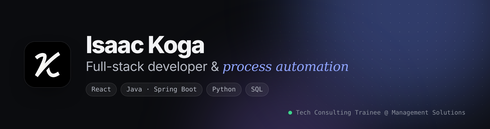

<picture>
  <source media="(prefers-color-scheme: dark)" srcset="assets/banner-dark.png">
  <source media="(prefers-color-scheme: light)" srcset="assets/banner-light.png">
  
</picture>

<p align="center">
  <a href="https://akog23.github.io"></a>
  <a href="https://www.linkedin.com/in/iskoga"></a>
  <a href="mailto:akog.sac@gmail.com"></a>
</p>

### Olá, eu sou o Isaac 👋

Toda empresa tem uma planilha que alguém atualiza na mão toda semana. **Eu gosto de encontrar essa planilha** — e transformar em código.

- 💼 **Trainee em Tech Consulting** na **Management Solutions**, conectando necessidades de negócio a soluções técnicas
- ⚡ Na **Huawei Brasil**, criei ~10 automações em Python e VBA que reduziram rotinas de 3–4 horas para **no máximo 10 minutos**
- 🎓 **Sistemas de Informação** na **Universidade Presbiteriana Mackenzie** (2024 – 2028)
- 🌱 Estudando agora: serviços em nuvem, teste de software e bancos de dados
- 🗣️ Português (nativo) · Inglês (intermediário)

```python
class Isaac:
    cargo       = "Trainee em Tech Consulting @ Management Solutions"
    cidade      = "São Paulo, Brasil"
    stack       = ["React", "Java / Spring Boot", "Python", "SQL"]
    superpoder  = "transformar planilhas de 4 horas em scripts de 10 minutos"
    tempo_livre = "jogos co-op no Steam 🎮"

    def bora_conversar(self):
        return "akog.sac@gmail.com"
```

### 🧰 Tecnologias

<p>
  
  
  
  
  
  
  
  
  
  
  
  
  
  
  
</p>

### 🚀 Projetos em destaque

| Projeto | O que é | Stack |
| :-- | :-- | :-- |
| [**MackEstágios**](https://github.com/akog23/MackEstagios) | Portal de gestão de estágios — API REST com autenticação, vagas, inscrições e painel administrativo | Java · Spring Boot · JWT · Next.js |
| [**VetCare**](https://github.com/akog23/P2_CLOUD) | Sistema para clínica veterinária publicado na AWS, com especificação, modelo ER e decisões de arquitetura | AWS · S3 · SQL |
| [**NeuroAIM**](https://github.com/akog23/NeuroAIM) | Jogo que apoia a reabilitação motora com exercícios gamificados | Java · libGDX |
| [**Pokédex iOS**](https://github.com/akog23/PokedeX) | App em SwiftUI com busca em tempo real e favoritos salvos, usando a PokéAPI | Swift · SwiftUI |

➡️ Mais projetos, experiência e formação no meu **[portfólio](https://akog23.github.io)**.

### 📜 Certificações

[AWS Cloud Architecting](https://www.credly.com/badges/ab2ec487-38b1-450a-b516-6b3d839bff94) ·
[Cisco CCNA: Introduction to Networks](https://www.credly.com/badges/81af8c0e-0925-45c1-81f3-4c8966ddbb80) ·
[Cisco Introduction to Cybersecurity](https://www.credly.com/badges/fa494f36-3eca-4dc1-8df8-5d2fa76daf0a) ·
[Cisco Introduction to IoT](https://www.credly.com/badges/f5adb67d-1d38-48d6-b2ea-5e81df1816a2) ·
Trilha Swift & iOS (TIC em Trilhas · Mackenzie)

---

<p align="center">
  <sub>💬 Tem um processo lento, um produto para tirar do papel ou uma vaga em tecnologia? <a href="https://www.linkedin.com/in/iskoga">Me chama no LinkedIn</a>.</sub>
</p>
